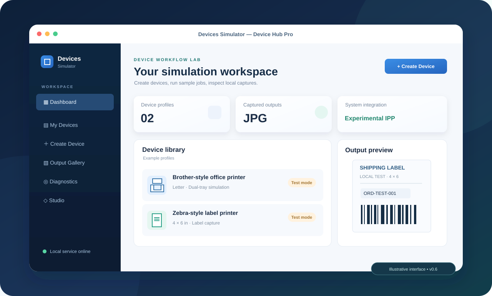
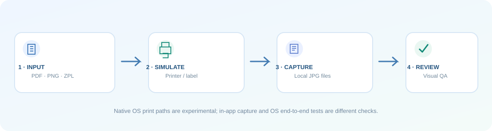
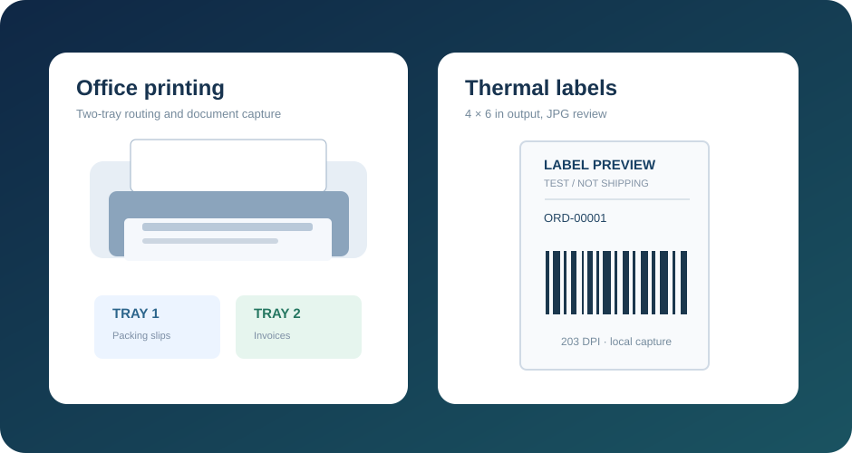

# Devices Simulator

**A local-first device workflow lab for teams building software that prints, labels, and scans.**

Test output, reproduce printer failures, and inspect captured JPGs without needing a full hardware lab for every test.

[**Download for Windows, macOS & Linux**](https://github.com/migtam628/devices-simulator/releases) · [Product page source](docs/index.html) · [Company evaluation](docs/COMPANY_EVALUATION.md) · [Support & feedback](https://github.com/migtam628/devices-simulator/issues)

This hero is an illustration, not a live application screenshot or proof of native OS device installation.

---

## Meet your hardware-independent testing workspace

Software teams building commerce, shipping, POS and internal operations systems face an awkward dependency: testing device workflows usually means maintaining real printers and scanners everywhere.

**Devices Simulator** helps developers, QA teams, and solution engineers create repeatable *local* testing scenarios for office printing, shipping labels, scanner fixtures, and barcode input. It makes generated output visible and simulated failures reproducible.

> **Early-access software:** The simulator accelerates testing. It does **not** prove physical printing, shipping fulfillment, native scanner installation, or certification by a hardware vendor.

### Feature overview

| Capability | Current support | Detail |
|---|---|---|
| Office printer simulation | **In-app + experimental OS queues** | Brother-style profiles, Letter media, two-tray settings |
| 4 × 6 thermal label simulation | **In-app + experimental OS queues** | Zebra-style label captures and partial ZPL II |
| Local document capture | **Available** | PDF, JPG, PNG and supported ZPL to JPG files |
| Printer fault testing | **Available** | Normal, offline, paper-out, jam and paused |
| Jobs, Gallery and Diagnostics | **Available** | Source documents, output files, metadata and trace information |
| CUPS end-to-end verification | **Experimental — macOS/Linux** | Confirm OS spooler → local IPP → JPG, not just a queued job |
| Flatbed scanner preview | **In-app fixture only** | Not an installed OS scanner |
| macOS barcode entry | **Experimental keyboard simulation** | Accessibility-based input, not a true HID or USB device |
| Studio shipping-station demo | **Available demo** | Capture sample Brother packing slip + Zebra label |
| WIA/eSCL scanner, true HID, ESC/POS, PrintNode certification | **Not implemented / unverified** | Tracked as future work |

## Device catalog: scales, BLE, USB & network peripherals

Devices Simulator now supports saved manufacturer/model/transport profiles across office and label printers, shipping scales, barcode scanners, document scanners, receipt printers, serial devices, BLE devices, USB peripherals, network devices, RFID readers and sensors.

In **Create Device**, pick a category → brand → model → connection. Each catalog profile only offers transports appropriate to that reference model. You can change a saved profile in **My Devices**.

**Shipping scale test bench (v0.7):** Generate local weight readings with gross weight, tare, kg/lb/g/oz output, stable/unstable state and over-capacity behavior. This is a *working in-app fixture*, not an installed DYMO/METTLER TOLEDO USB or Bluetooth device. USB, BLE and network selections are saved configurations until their adapters are implemented.

Read the **[Device catalog and transport architecture](docs/DEVICE_CATALOG_PROTOCOLS.md)** for researched models, official manufacturer sources and the native transport roadmap.

## Experimental macOS virtual HID POS scale (v0.8)

The app now includes an opt-in native **CoreHID** prototype for a generic POS shipping scale on macOS 15+. It encodes USB-IF scale reports and provides Activate, Send weight, Check OS enumeration and Deactivate controls.

**Apple's HID virtual-device entitlement is required.** Ordinary unsigned Releases do not have approved entitlements. An attempted activation can fail with a precise diagnostic; the app must not show a connected device unless the OS accepts it. Even if it enumerates, this is NOT a DYMO M10 USB identity/VID/PID clone.

See the [macOS CoreHID scale development and test guide](docs/MACOS_COREHID_SCALE.md). Other OS HID drivers remain planned.
## Advanced Studio — editable workflow engine (v0.9.0)

Studio now has a visual workflow editor, a saved workflow library, configurable nodes and connections, drag positioning, revision protection and run history. A Shipping Station template can route sample barcode data through an optional scale fixture into Brother/Zebra captures, then an output report.

**Supported:** Start → Barcode Data → Scale Reading → Printer/Scanner Capture → Output. All runs use **in-app local fixtures**, not OS printer queues. Failed steps block their downstream dependencies while independent branches can still complete. View local JPG captures in the run log.

**Not yet supported:** External USB/BLE/network data streams, live remote devices, background triggers, arbitrary scripts, OS printing, or automatic order fulfillment.

[Advanced Studio technical architecture and roadmap](docs/ADVANCED_STUDIO.md)

## Universal Connection Engine — TCP milestone (main branch)

The first **real external connection adapter** is available in v0.10.0: an **opt-in loopback TCP server** for shipping-scale fixtures. Another local application can open a socket, send a line-delimited \`SI\` (immediate) or \`S\` (stable) command, and read back a tare-adjusted scale value using a limited MT-SICS-style response. It supports simulated unstable, overload, busy and disconnect states, plus connection telemetry.

**This is not** a registered USB/HID device, a serial/COM driver, a BLE peripheral, or a certified METTLER TOLEDO BC emulation. TCP listens only on \`127.0.0.1\`, never starts automatically, and requires explicit activation in the **Connections** dashboard (or authenticated Hub API). The scale reference profile must have **Network** selected.

See the [Connection Engine guide](docs/CONNECTION_ENGINE.md) for the exact API, socket examples, security and troubleshooting. Windows/macOS/Linux runtime verification is tracked separately from Python socket tests.

## Who it's for

**QA engineering:** Reproduce print payloads, rendering issues and device-failure scenarios in a controlled environment.

**Shipping & fulfillment software:** Preview 4 × 6 labels, packing slips and internal paperwork before testing the physical printer.

**Retail, POS and kiosk vendors:** Exercise queue selection and document flows before store deployment.

**Solution engineers and demo teams:** Demonstrate realistic workflows without carrying a whole set of devices to every meeting.

For pilots, deployment readiness, support boundaries and commercial-use questions, read the **[Company evaluation guide](docs/COMPANY_EVALUATION.md)**.

## macOS CUPS "Waiting for job to complete" / no JPG (v0.8.1)

The IPP server previously rejected streaming HTTP `Transfer-Encoding: chunked` requests because it required `Content-Length`. v0.8.1 decodes bounded chunked uploads and records CUPS job-state polls.

After installing the new build, fully quit the old simulator process, reopen the app, and check:

    curl -s http://127.0.0.1:8631/healthz | python3 -m json.tool
    curl -s http://127.0.0.1:8631/diagnostics | python3 -m json.tool
    lpstat -v Lulwa_SIM_Zebra_4x6
    lpstat -p Lulwa_SIM_Zebra_4x6 -l
    lpstat -o Lulwa_SIM_Zebra_4x6

If a previous simulator test job is still stuck, cancel that job in macOS printer queue, or intentionally cancel every pending job from the **simulated Zebra queue only** using `cancel -a Lulwa_SIM_Zebra_4x6`. Then use **System Integration → Verify OS Print → JPG** again.

Diagnostics track operation state codes (3=pending, 8=aborted, 9=completed). Installation in the OS is not proof of a captured JPG.

See [CUPS troubleshooting](docs/CUPS_JPG_TROUBLESHOOTING.md) for detailed interpretation and safeguards.
## Download the app

[**Browse published releases**](https://github.com/migtam628/devices-simulator/releases)

| Platform | Package | Important requirement |
|---|---|---|
| Windows x64 | Portable ZIP with <code>DevicesSimulator.exe</code> | Keep its bundled files; WebView2 may be required |
| macOS Apple Silicon | ZIP with <code>DevicesSimulator.app</code> | Unsigned early-access build |
| macOS Intel | ZIP with <code>DevicesSimulator.app</code> | Unsigned early-access build |
| Linux x64 | TAR.GZ with <code>DevicesSimulator</code> | Opens the hub in your system browser |

Python is bundled with the portable executables. Packages are development builds, **not signed or notarized installers**. Read [desktop packaging notes](docs/DESKTOP_BUILDS.md) for checksums and platform requirements.

### First run

1. Open Devices Simulator and select **Create Device**.
2. Choose **Brother Dual Tray** or **Zebra 4 × 6**, configure the profile, and save it.
3. Choose **Generate Sample** or import a document.
4. Open **Output Gallery** to inspect your real local JPG files.
5. Use **System Integration** only when you want to test experimental native printer queues.

By default, capture output is stored under the user's Documents folder, in a profile-named directory. A captured job keeps the original input, one or more JPG pages and a <code>job.json</code> record.

### Where your data goes

Core capture runs **locally** and does not require a cloud account. Your labels and documents can still contain sensitive order information. Control local filesystem permissions, storage location and manual cleanup; there is not yet an enterprise retention-management guarantee.

## What “installed” means

There are three separate milestones:

1. **Profile created:** the simulator knows what to emulate.
2. **OS printer queue registered:** Windows/macOS/Linux recognizes a local IPP queue, where supported.
3. **OS job captured:** a print job reaches the simulator and produces a verifiable JPG.

A successful result at milestone 2 **does not guarantee** milestone 3. Printer drivers, supported formats, queue status and operating-system behavior still matter.

### Fixing “CUPS accepted the job, but no JPG arrived”

The **v0.6.1 print-path update** addresses a protocol gap: the server now handles both a single IPP Print-Job and the two-stage **Create-Job → Send-Document** sequence used by some CUPS clients. It also reports IPP activity and distinguishes a captured job from a job that was merely accepted by the OS spooler.

First, download the newest release, **quit the previous simulator completely**, and restart the app. In **System Integration**, check that the simulated printer queue is registered, then run **OS Print → JPG verification**.

On macOS/Linux, use these diagnostics in Terminal:

    # Verify OS queue and local simulator
    lpstat -p
    lpstat -v
    curl http://127.0.0.1:8631/healthz

    # See IPP operations, format and capture status (not document contents)
    curl http://127.0.0.1:8631/diagnostics

    # Check whether the spooler is holding a Brother test job
    lpstat -p Lulwa_SIM_Brother -l
    lpstat -o Lulwa_SIM_Brother

If **no Print-Job or Send-Document request** appears in diagnostics, investigate CUPS queue delivery and document-format conversion. If an IPP request arrives but capture fails, inspect its status and error. Supported formats and conversions vary by OS.

> GitHub's automated tests check the IPP two-stage submission and local JPG pipeline. We cannot certify your particular Mac or driver configuration without testing that host. See [OS printer setup](docs/OS_PRINTERS.md).

## Simulated scanning and barcode entry

**Flatbed scan fixture:** Imports or generates sample images within the app. It does *not* install a scanner into macOS Printers & Scanners or Windows Devices & Printers.

**Barcode input simulator:** On macOS, the app can send barcode characters via Quartz keyboard events after explicit approval. It needs Accessibility permission and is **not** a permanent HID/USB device. Try it only with an empty, nonsensitive document or test form in focus.

## From source

Requires Git and Python 3.10+.

macOS and Linux:

    git clone https://github.com/migtam628/devices-simulator.git
    cd devices-simulator
    python3 -m venv .venv
    source .venv/bin/activate
    python3 -m pip install -e '.[test]'
    python3 -m pytest -q
    lulwa-hub

Windows PowerShell:

    git clone https://github.com/migtam628/devices-simulator.git
    cd devices-simulator
    py -3 -m venv .venv
    .\.venv\Scripts\Activate.ps1
    python -m pip install -e ".[test]"
    python -m pytest -q
    lulwa-hub

For the optional native desktop wrapper install the <code>desktop</code> dependency group and launch <code>lulwa-desktop</code>. Native OS webview prerequisites still apply.

### Implementation map

    Desktop hub and wizard
          │
          ├─ Device profiles and simulated fault states
          ├─ Jobs / gallery / diagnostics
          ├─ Capture engine: PDF, image, partial ZPL → JPG
          ├─ IPP service and experimental OS printer queues
          ├─ Scan preview fixture (not an OS scanner)
          └─ macOS barcode keyboard input (not HID hardware)

The Python package is in <code>src/lulwa_virtual_printer/</code>. Desktop packaging lives in <code>packaging/</code>. GitHub Actions builds Windows, macOS and Linux executables, smoke-tests them, and publishes versioned experimental [Releases](https://github.com/migtam628/devices-simulator/releases).

## Product roadmap

Tracked in [GitHub Issues](https://github.com/migtam628/devices-simulator/issues):

- Native eSCL/AirScan and Windows WIA scanner support
- True virtual HID/keyboard devices with platform-appropriate permissions and signing
- Full ZPL and ESC/POS support with barcode fidelity validation
- Verified PrintNode interoperability
- Editable workflow Studio, reusable test scenarios and persistence
- Signed installers, managed updates and retention controls

### Business use and licensing

**No software license terms are currently specified.** Public access to the repository does not automatically grant a company commercial-use or redistribution rights. Please contact the maintainer via the [issue tracker](https://github.com/migtam628/devices-simulator/issues) to establish appropriate licensing and support terms before deployment.

Devices Simulator is independent experimental software. References to Brother and Zebra identify representative test profiles, not an affiliation or endorsement.

---

<strong>Test the workflow. Not your patience.</strong> 
<a href="https://github.com/migtam628/devices-simulator/releases">Downloads</a> · <a href="docs/index.html">Product page</a> · <a href="docs/COMPANY_EVALUATION.md">For teams</a> · <a href="https://github.com/migtam628/devices-simulator/issues">Feedback</a>

